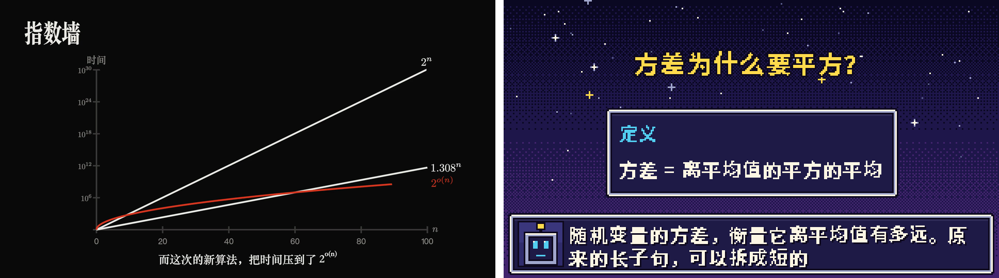
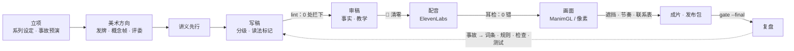
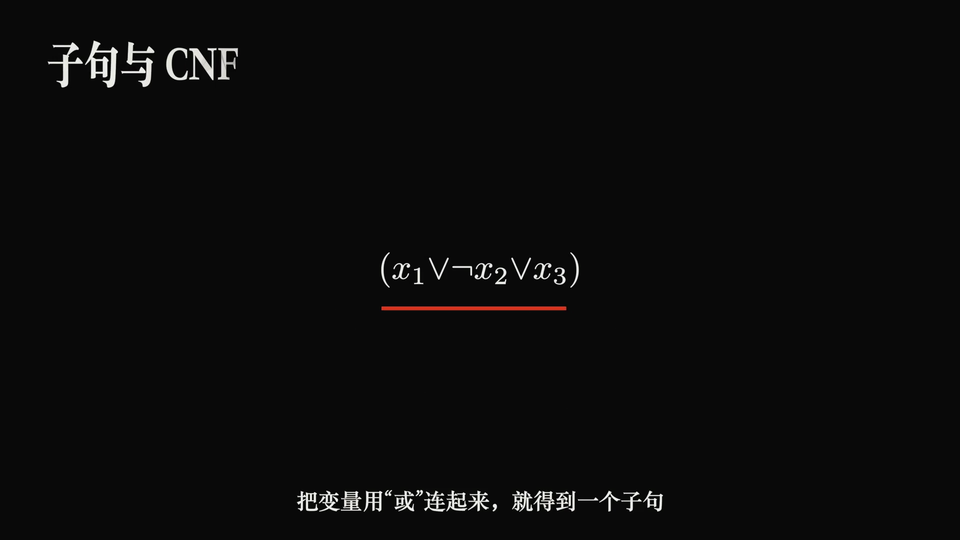
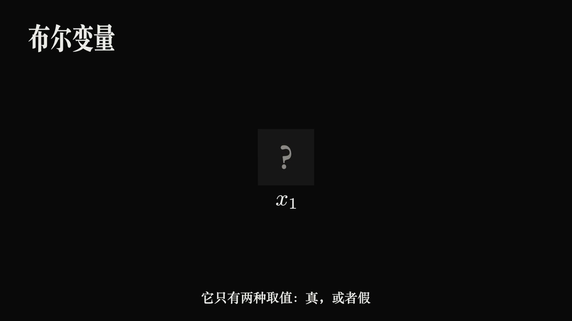

<div align="center">

# 科普番剧工坊 · kepu-studio

**把动漫 / 动画 / 游戏风中文科普视频的整条生产线，装进一个 Claude Code 插件。**<br>
<sub>An end-to-end Claude Code plugin for anime- and game-style Chinese science explainers.</sub>

<br>

    

<br>



<sub>左：ManimGL 动漫标题卡引擎（来自《ETH 之墙》）。右：像素 RPG 引擎（来自《地基之下》）。两张都是用插件自带的引擎、配免费占位配音渲染出来的原始帧。</sub>

</div>

<br>

这套流程合并了两部作品的实战经验，十几轮返工的教训都已经写进了工具和关卡：

- **《地基之下》**：中文数理逻辑系列。像素 RPG 风，两季 27 集，每集配一讲讲义。
- **《ETH 之墙》**：复杂性理论系列。ManimGL 做的 EVA 标题卡风，6 期，每期 25–30 分钟，另有英文版。

装好以后，直接对 Claude 说话就行：“开一个新系列，讲图论”“做第 1 期”“这期配音”“第 3 期 2:15 的‘数’读错了”。

## 它解决什么

| 痛点 | kepu 的做法 |
|---|---|
| AI 配音老念错多音字：长子句念成 zhǎng，可数、方差、“行”也常错 | **合成前把读音定死**。三层读音词典、上下文规则、分词陷阱检测一起把关；定下来的读音换成只有一个读音的替身字，字幕照写原字。还没定的地方直接拦下，不合成。 |
| 希腊字母念不对：σ 念成 sick，φ 念成“非” | **默认按英文念**。每个音色只校准一次，结果所有项目共用。 |
| 不知道哪里念错了，全片复听又太累 | **耳检包**：只截出高风险的几十处，每处 2–3 秒，一页点完。 |
| 画风像 PPT，或者只是贴了一层游戏皮 | **taste 方法**：18 个动漫 / 游戏方向随机发牌，写 IDEA 句、过竞品测试、出概念帧，再由独立评委打分。 |
| 讲义、逐字稿、字幕、B 站分段互相对不上 | **同一份稿子**生成全部：讲义 PDF、逐字稿、分段、.srt。 |
| 有的观众跟不上，有的嫌浅 | **分级**：难度分 L1 主线、L2 进阶、L3 硬核支线；严谨度分完整、骨架、黑箱。可以一键出只含主线的精简版。 |
| “这期做完了吗？”没有统一答案 | **一张表的关卡**：脚本、配音、画面、发布四个阶段，只要有 ✗ 就不往下走。 |
| 同样的错误反复出现 | **复盘回路**：每个事故都要回答“为什么没被更早的关卡拦住”，然后改系统，并补一条回归测试。 |

## 九个阶段，九道关卡



每个阶段都有对应的技能（`/kepu-studio:new`、`art`、`script`、`pronounce`、`voice`、`notes`、`review`、`publish`、`fix`、`retro`），由总技能 `/kepu-studio:studio` 串起来。

## 读音引擎：一个词只定一次

```console
$ ./kepu pron "原来的长子句，可以拆成短的；随机变量的方差为零，设σ等于零点五"
发给模型：原来的尝子句，可以拆成短的；随机变量的方插违零，设 sigma 等于零点五
  ✓  原来的【长】子句，可以拆          cháng（尝）     词典 长〔cháng〕子句
  ✓  ；随机变量的方【差】为零，设σ等   chā（插）       词典 方差〔chā〕
  ✓  ；随机变量的方差【为】零，设σ等于 wéi（违）       规则 为真/为零/为 x
```

```console
$ ./kepu lint script/episodes/ep01.md
  ✗ 未定  没有任何东西【藏】在箱子里     分词陷阱：词条“西藏”说 zàng，但切成“东西”时念 cáng
    → 稿子里标 藏〔cáng〕（只管这一处）；以后都这么念：kepu lexicon add "东西藏〔cáng〕"
  ✗ 未定  OpenAI 宣布【了】解答         分词陷阱：词条“了解”说 liǎo，但切成“解答”时念 le
```

- **决定只来自三个地方**：稿子里的标记 `字〔读音〕`、三层词典（插件内置约 700 条 → 个人 `~/.kepu` → 项目），以及上下文规则。通用词典（jieba + pypinyin）只负责“发现风险”，不替你做决定。原因是它在理工科词上常出错：方差标成 chà，相变标成 xiāng，背包标成 bēi，用处标成 chǔ。
- **分词陷阱检测**：同一个字在两种说得通的切分里读音不同，就拦下来问人。例如长子+句 / 长+子句、东西+藏 / 东+西藏、能量出、零处分组、宣布了解答。
- **替身字**：必须只有一个读音，而且两岸同音（“档”“储”在台湾读法不同，已经撤掉）。新的替身字第一次用时会自动进耳检包。
- **每次改稿都会自动检查**：插件带了一个钩子，Claude 一改稿子就跑 `kepu lint`。

| 在两部作品全部稿子上的验证 | 结果 |
|---|---|
| 51 个文件、5860 条旁白 | 拦下 812 处 → **26 处**，剩下的几乎都是真实的分词陷阱 |
| 《地基之下》第五轮审计的 537 处风险 | 和审计结论一致 **93.2%**，拦下 1.1%；不一致的那部分是作者后来改定的“当成念 dāng” |
| 和《ETH》审定读音逐处比对（6 期，4724 处） | 4648 处相同，**新增 70 处保护**；还发现 ETH 现行词规则里一个潜伏的误配（`数完` 误配进“计数完美匹配”） |

## 希腊字母：英文读音，每个音色校准一次


- 多音节字母送英文拼写，比如 alpha、sigma、lambda。
- 单音节字母另外准备了能确定念出英文音的写法，作为候选：τ→套（tau）、ψ→赛（psi）。
- 默认写法是作者在默认音色 Susan · eleven_v4 上逐个试听选定的（2026-10-29）：π→pie、φ→phi、χ→kai、ν→nu、λ→Lambda、τ→套、ψ→赛，其余字母用英文拼写。
- 换了音色，所有字母都按“没验证”处理，需要重新试听。φ 虽然已经验证过，每期第一次出现仍然会进耳检包，因为“φ 或非 φ”这类逻辑式里曾经念成 fi。
- `kepu greek audition` 合成全部候选，生成上面这个试听页（音频直接嵌在页面里），大约 800 字符。选完导出，再 `kepu greek ingest`，结果写进音色档案，所有项目共用。

## 耳检包：只听高风险的几十处


- **会被收进来的**：送拼音的地方、新替身字、还没验证的希腊字母、低频词、缩写、数字，再加 5 处随机抽查作为对照组。
- **快捷键**：J/K 上下翻，空格播放，1 标对，2 标错。
- **用法**：导出结果后运行 `kepu earcheck ingest`。判错的替身字以后自动换掉，同时列出需要重录的 beat。

## 美术方向：从题材里长出来


<sub>《ETH 之墙》做过的六个方向（每个方向一张标题卡 + 一张内容帧），最后选了 EVA。生成这些帧的代码就在 anime 引擎的 `concepts/` 里。</sub>

1. **盘点题材**：列出 8–12 样只属于这个题材的东西。
2. **发牌**：`kepu art deal`，脚本发，模型不挑，免得每次都落回同一套默认风格。
3. **IDEA 句加竞品测试**：“在这个系列里，[题材自己的东西] 变成 [画风装置]”。把题材换成别的，这句话还成立的话，说明它只是一层皮。
4. **概念帧**：每个方向出两帧，用最终的渲染器画。
5. **独立评委打分**：设计 40 / 可用 30 / 创意 20 / 内容 10。出现渐变、发光、细线装饰、编号、等宽标签，总分封顶 6.5。
6. **落成系统**：配色 token、三档字号、签名动作、节奏预算。

<details>
<summary>方向库里的 18 个方向</summary>

| 方向 | 装置 | 引擎 |
|---|---|---|
| EVA 标题卡 | 红色判定线切开画面；结论用满屏大字卡 | anime |
| 像素 RPG · 无限地牢 | 对话框字幕；黑箱是上锁的宝箱 | pixel |
| 怪盗预告信（女神异闻录 5） | 斜切转场；“偷走你的误解”的预告信 | anime |
| 机械纪元 UI（NieR） | 推理每一步是一条系统日志 | anime |
| 深渊灯笼（空洞骑士） | 变量为真时灯笼点亮 | anime |
| 不可能的建筑（纪念碑谷） | 旋转视角，两条路就接上了 | anime |
| 地铁线路图（Mini Metro） | 画线连站：归约链就是线路 | anime |
| 法庭举证（逆转裁判） | “异议！”：反证法即举证 | 两者 |
| 规则积木（Baba Is You） | 推动规则方块，公理随之改变 | pixel |
| 卡牌构筑（杀戮尖塔 / Balatro） | 引理是卡牌，定理是连招 | 两者 |
| 回合制对战 | 敌手论证；HP 条是剩余的可能性 | pixel |
| 神庙试炼（塞尔达） | 一个概念一座神庙 | 两者 |
| 文字演出（Shaft） | 满屏字卡闪切 | anime |
| 涂地墨水（喷射战士） | 占领的面积就是概率 / 测度 | anime |
| 方块消行（俄罗斯方块） | 组合、装箱、消行 | pixel |
| 流水线工厂（异星工厂） | 数据在传送带上流过一台台机器 | 两者 |
| 红石电路（我的世界） | 逻辑门通电 | pixel |
| 扁平水彩（吉卜力式） | 季节流转，参数随之变化 | anime |

只借这些画风的构图、色彩和动作语法，不用任何原作的角色、logo、字体或素材。
</details>

## 两套渲染引擎

<table>
<tr>
<td width="50%"></td>
<td width="50%"></td>
</tr>
</table>

| | anime（ManimGL 1.7.2） | pixel（像素 RPG） |
|---|---|---|
| 来自 | 《ETH 之墙》 | 《地基之下》 |
| 依赖 | venv + manimgl + LaTeX + 宋体 | 只要 numpy + Pillow |
| 字幕 | 宋体粗字烧录，跟随底色反相 | RPG 对话框，打字机效果，逐字同步 |
| 节奏 | 引擎自动计数大字卡、插卡、判定线，超预算就报警 | 遮挡、出框、空白都有自动检查 |
| 配音 | 读取 `kepu voice` 生成的 `beats.json`（逐字时间戳，精度约一帧） | 同左 |

## 讲义 · 逐字稿 · 分级

- **讲义先写，稿子后写**：屏幕上的定理从讲义里复制。
- `kepu notes build` 生成可打印的 HTML 和 PDF，公式由 KaTeX 渲染。
- 讲义里的元素：
  - 本期地图（三档目标）、进阶框、硬核支线框；
  - 定理旁的严谨度徽章；
  - 常见误解卡与实情卡；
  - ★ 到 ★★★ 的习题；
  - 带读音的术语表。
- **严谨契约**：视频里的角标可以比讲义低，不能比讲义高。
- `kepu stats` 会统计：
  - 各难度等级的时长占比；
  - 有没有从 L1 直接跳到 L3；
  - 提问间隔、句长。
- `--cut L1` 输出只保留主线的精简版清单。
- `kepu transcript` 从同一份稿子生成逐字稿、B 站分段、.srt，三者天然一致。

<p align="center"></p>

## 元认知：让流程自己发现自己的错

1. **事故预演**：开工前假设“发布后被骂了”，写下最可能的 5 个原因。每个原因对应一道关卡；对应不上，就新加一道检查。
2. **决定账本**：读音、配色、比喻、希腊字母，作者定过的都写进文件，不靠任何人的记忆。
3. **检查器先校准**：新的检查器先喂已知的坏例子，确认判得出来。whisper 会把念错的字按上下文“纠正”回来，所以不拿它验收读音。
4. **人的注意力只花在高风险处**：耳朵听耳检包，眼睛看联系表；作者只回答偏好题，而且每题都给候选。
5. **复盘回路**：同一类错误出现第二次，说明上次只修了个例，没修系统。

两部作品的完整复盘见 [`lessons.md`](kepu-studio/skills/studio/references/lessons.md)。每一条都写成“事 → 根子 → 以后 → 插件里落在哪”。

## 安装

> 这是**私有仓库**。请作者在 Settings → Collaborators 里把你的 GitHub 账号加进来。

**Claude Code（推荐）**。需要你的 git 能访问这个私有仓库：

```bash
claude plugin marketplace add xiaoyulics/kepu-studio
claude plugin install kepu-studio@kepu-studio-market
```

**从压缩包安装**。在 [Releases](https://github.com/xiaoyulics/kepu-studio/releases) 下载 `kepu-studio.zip`，解压，然后：

```bash
claude plugin marketplace add ./kepu-studio
claude plugin install kepu-studio@kepu-studio-market
```

**Claude 桌面版 / Cowork**：进入 Customize → Plugins → Add → Upload plugin，选 Releases 里的 `kepu-studio-plugin.zip`。

**只想试试**：`claude --plugin-dir ./kepu-studio`。

## 快速开始

```bash
python3 <插件目录>/toolkit/kepu_run.py init 我的系列 --engine pixel   # 或 --engine anime / none
cd 我的系列
./kepu doctor        # 逐项检查环境
./kepu selftest      # 读音引擎回归测试
```

然后在 Claude 里说“开一个新系列，讲 ××”。也可以直接用命令：

| 命令 | 作用 |
|---|---|
| `./kepu lint 稿子` | 写稿检查：格式、读法、多音字，每一处都附现成修法 |
| `./kepu lexicon add "长〔cháng〕子句" [--scope user]` | 定一个词的读音，以后都这么念 |
| `./kepu stats 稿子 [--cut L1]` | 时长、节奏、提问间隔、分级占比，以及主线精简版 |
| `./kepu voice 稿子 --dry` / `--only 03 04` / `--engine edge` | 估价 / 只合成指定 beat / 用免费占位配音 |
| `./kepu earcheck build 稿子` / `ingest 结果.json` | 生成耳检包 / 把耳检结果写回 |
| `./kepu greek audition` / `ingest` | 按音色校准希腊字母读音 |
| `./kepu art deal --subject "题材"` | 美术方向发牌 |
| `./kepu notes new 稿子` / `build 讲义.md` | 讲义骨架 / 生成 HTML 和 PDF |
| `./kepu transcript 稿子` | 逐字稿、B 站分段、.srt |
| `./kepu gate 稿子 [--final]` | 四个阶段的关卡汇总成一张表 |

## 仓库结构

```
.
├── .claude-plugin/marketplace.json     # 插件市场（kepu-studio-market）
├── docs/images/                        # README 用图
└── kepu-studio/                        # 插件本体
    ├── .claude-plugin/plugin.json
    ├── skills/      studio new art script pronounce voice notes review publish fix retro
    ├── agents/      kepu-fact-checker · kepu-pedagogy-reviewer · kepu-av-reviewer · kepu-style-juror
    ├── hooks/       改稿后自动跑读音检查
    ├── toolkit/     kepu 工具（只用 Python 标准库）+ 回归测试 + 数据（词表、替身字、词典、希腊字母、方向库）
    └── templates/   engine-anime（ManimGL）· engine-pixel（像素 RPG）
```

## 许可与来源

- 读音词表由 jieba 和 pypinyin 的词典生成，两者都是 MIT 许可，详见 [`THIRD_PARTY.md`](kepu-studio/toolkit/kepu/data/THIRD_PARTY.md)。
- taste-skill 本身没有打包进来（它的分发许可没有写明）。插件里附带了它迁移到视频上的浓缩版；如果你本机装了 taste-skill，art 技能会自动读它。
- 两套引擎和整套流程来自作者自己的两部作品。
