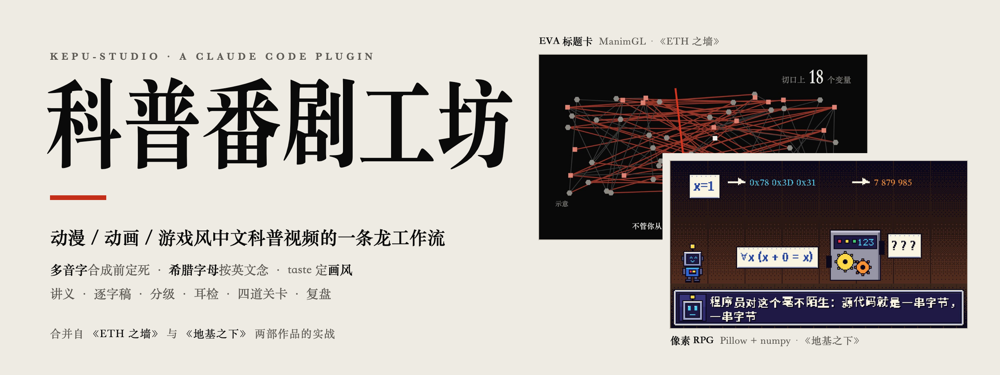
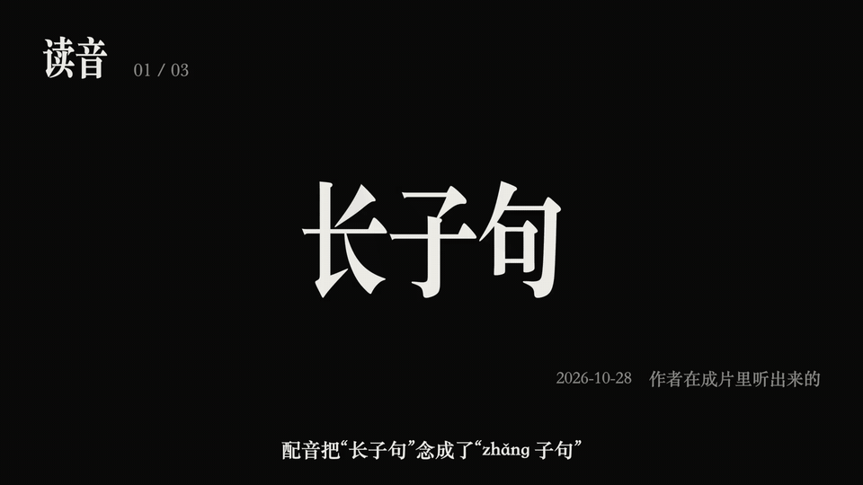
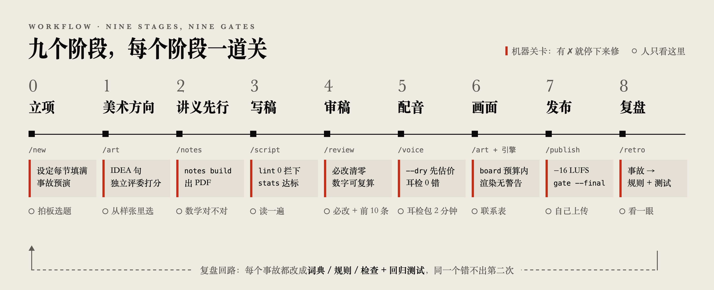
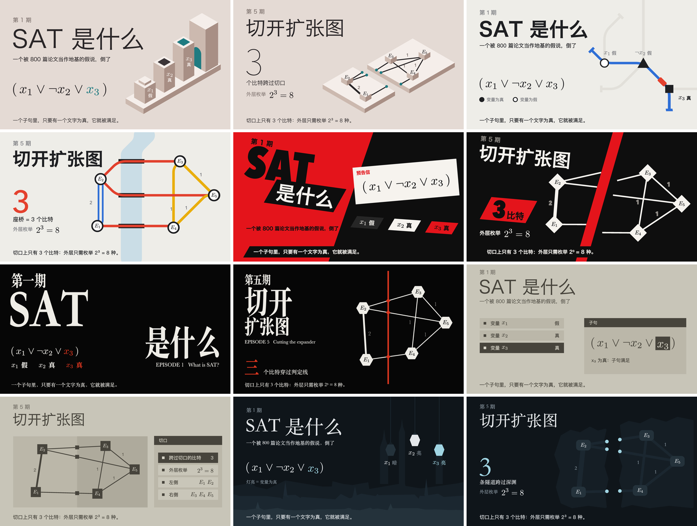
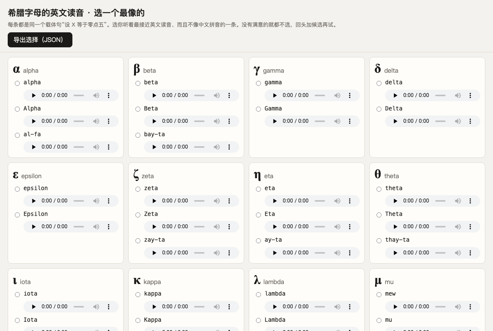
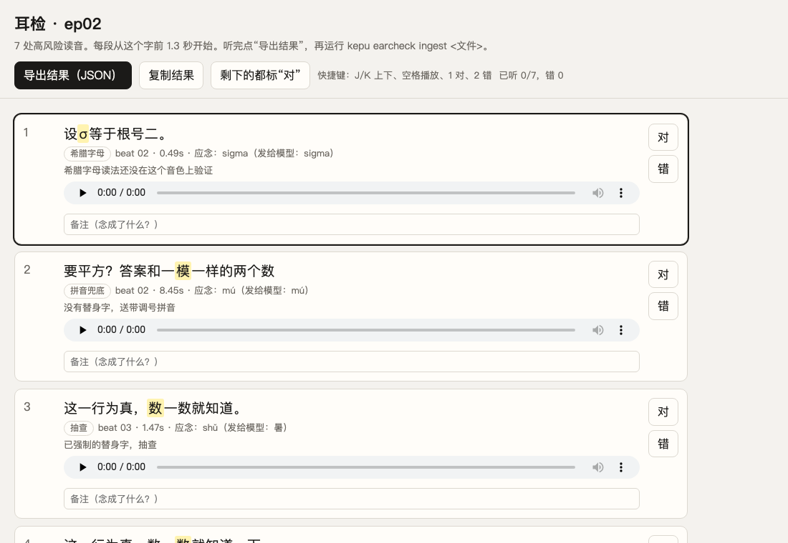
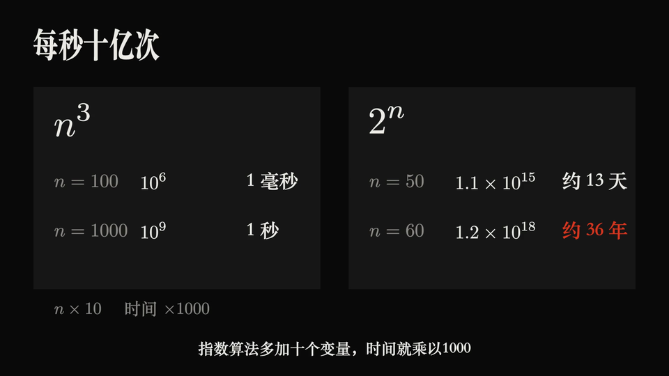
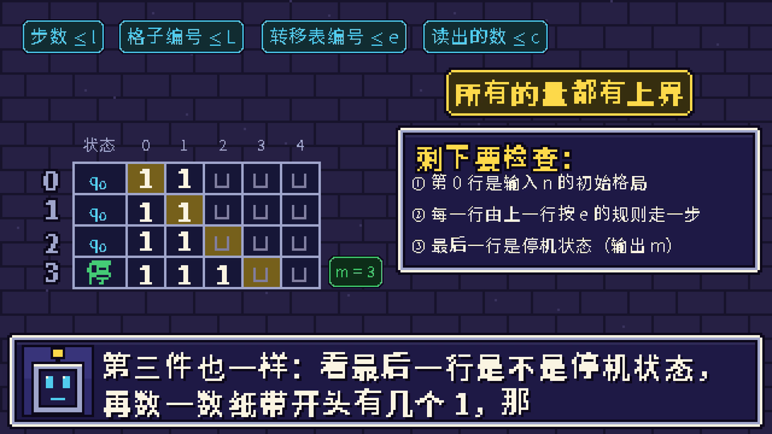
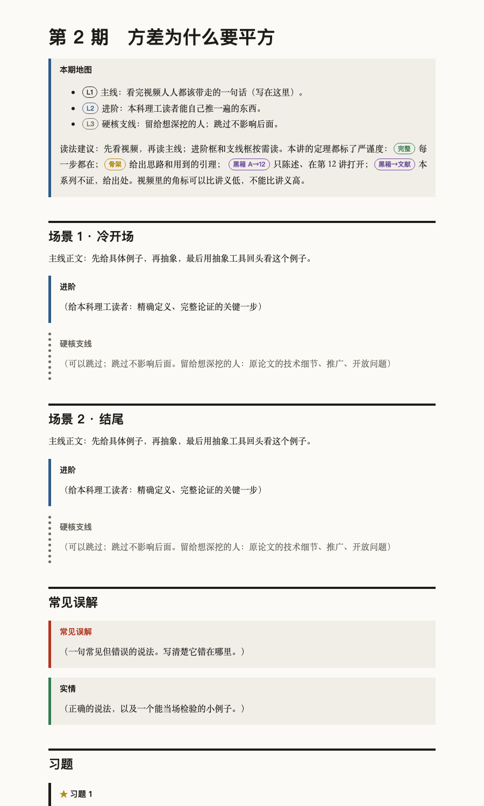

<div align="center">

<picture>
  <source media="(prefers-color-scheme: dark)" srcset="docs/images/banner-dark.png">
  
</picture>

<br><br>

 [](LICENSE)    

[宣传片](#宣传片) · [它解决什么](#它解决什么) · [工作流](#工作流) · [美术方向](#美术方向) · [读音引擎](#读音引擎) · [希腊字母](#希腊字母) · [耳检包](#耳检包) · [两套引擎](#两套引擎) · [讲义与分级](#讲义与分级) · [0.2 新增](#02-新增) · [安装](#安装) · [命令](#命令)

</div>

<br>

把**动漫 / 动画 / 游戏风中文科普视频**的整条生产线装进一个 Claude Code 插件：选题、美术方向、讲义、稿子、读音、配音、耳检、画面、发布、复盘，每一步都有一道机器关卡，人只在高风险的地方出手。

它合并自两部作品的实战，十几轮返工的教训都已经写进了工具和关卡里：

| 《地基之下》 | 《ETH 之墙》 |
|---|---|
| 数理逻辑系列。像素 RPG 风，两季 27 集，每集配一讲讲义 | 复杂性理论系列。ManimGL 做的 EVA 标题卡风，6 期，每期 25–30 分钟，另有英文版 |

装好以后直接对 Claude 说话：“开一个新系列，讲图论”“做第 1 期”“这期配音”“第 3 期 2:15 的‘数’读错了”。

<table>
<tr>
<td align="center"><b>11</b><br><sub>技能</sub></td>
<td align="center"><b>4</b><br><sub>独立审稿 agent</sub></td>
<td align="center"><b>709</b><br><sub>内置读音词条</sub></td>
<td align="center"><b>25</b><br><sub>回归测试，每条都是真事故</sub></td>
<td align="center"><b>2</b><br><sub>渲染引擎</sub></td>
<td align="center"><b>18</b><br><sub>动漫 / 游戏美术方向</sub></td>
</tr>
</table>

## 宣传片

<p align="center">
  <a href="https://github.com/Polaris-Aeterna/kepu-studio/releases/download/v0.2.3/kepu-studio_promo.mp4"></a>
  <br>
  <sub>▶ 点图看完整宣传片（1 分 45 秒 · 1080p · 有声）。稿子、读音、配音、画面全部是 kepu-studio 自己做的，源码在 <a href="examples/promo"><code>examples/promo</code></a>。</sub>
</p>

## 它解决什么

| 痛点 | kepu 的做法 |
|---|---|
| 画风像 PPT，或者只是贴了一层游戏皮 | **taste 方法**：18 个方向随机发牌，写 IDEA 句、过竞品测试、出概念帧，独立评委打分 |
| AI 配音老念错多音字：长子句念成 zhǎng，可数、方差、“行”也常错 | **合成前把读音定死**。三层读音词典、上下文规则、分词陷阱检测一起把关；定下的读音换成只有一个读音的替身字，字幕照写原字。没定的地方直接拦下，不合成 |
| 希腊字母念不对：σ 念成 sick，φ 念成“非” | **默认按英文念**。每个音色只校准一次，所有项目共用 |
| 不知道哪里念错了，全片复听又太累 | **耳检包**：只截出高风险的几十处，每处 2–3 秒，一页点完，约 2 分钟 |
| 讲义、逐字稿、字幕、B 站分段互相对不上 | **同一份稿子**生成全部 |
| 有的观众跟不上，有的嫌浅 | **分级**：L1 主线、L2 进阶、L3 硬核支线；严谨度分完整、骨架、黑箱。一键出主线精简版 |
| 大字卡用到第十次，就没有重音了 | **分镜节奏预算**：大字卡、插卡、签名动作有上限，两次之间至少隔 20 秒 |
| “这期做完了吗？”没有统一答案 | **关卡**：脚本、配音、画面、发布四个阶段一张表，有 ✗ 就不往下走；`kepu status` 看整个系列 |
| 同样的错误反复出现 | **复盘回路**：每个事故都要回答“为什么没被更早的关卡拦住”，然后改系统，补一条回归测试 |

## 工作流

<picture>
  <source media="(prefers-color-scheme: dark)" srcset="docs/images/pipeline-dark.png">
  
</picture>

- **技能**：每个阶段一个（`/kepu-studio:new`、`art`、`notes`、`script`、`pronounce`、`review`、`voice`、`publish`、`fix`、`retro`），总技能 `/kepu-studio:studio` 把它们串起来。
- **审稿 agent**：事实核查、教学审稿、审片、美术评委，四个都独立于写稿的那个。
- **钩子**：Claude 每改一次稿子，自动跑一次读音检查；没问题就不说话。

## 美术方向



<sub>《ETH 之墙》做过的六个方向，每个方向一张标题卡 + 一张内容帧，最后选了 EVA。生成这些帧的代码就在 anime 引擎的 <code>concepts/</code> 里。</sub>

1. **盘点题材**：列出 8–12 样只属于这个题材的东西。
2. **发牌**：`kepu art deal`。脚本发牌，模型不挑，免得每次都落回同一套默认风格。
3. **IDEA 句 + 竞品测试**：“在这个系列里，[题材自己的东西] 变成 [画风装置]”。换个题材这句话还成立，说明它只是一层皮。
4. **概念帧**：每个方向两帧，用最终的渲染器画。
5. **独立评委**：设计 40 / 可用 30 / 创意 20 / 内容 10。出现渐变、发光、细线装饰、编号、等宽标签，总分封顶 6.5。
6. **落成系统**：配色 token、三档字号、签名动作、节奏预算。

<details>
<summary>方向库里的 18 个方向</summary>

| 方向 | 装置 | 引擎 |
|---|---|---|
| EVA 标题卡 | 红色判定线切开画面；结论用满屏大字卡 | anime |
| 像素 RPG · 无限地牢 | 对话框字幕；黑箱是上锁的宝箱 | pixel |
| 怪盗预告信（女神异闻录 5） | 斜切转场；“偷走你的误解”的预告信 | anime |
| 机械纪元 UI（NieR） | 推理每一步是一条系统日志 | anime |
| 深渊灯笼（空洞骑士） | 变量为真时灯笼点亮 | anime |
| 不可能的建筑（纪念碑谷） | 旋转视角，两条路就接上了 | anime |
| 地铁线路图（Mini Metro） | 画线连站：归约链就是线路 | anime |
| 法庭举证（逆转裁判） | “异议！”：反证法即举证 | 两者 |
| 规则积木（Baba Is You） | 推动规则方块，公理随之改变 | pixel |
| 卡牌构筑（杀戮尖塔 / Balatro） | 引理是卡牌，定理是连招 | 两者 |
| 回合制对战 | 敌手论证；HP 条是剩余的可能性 | pixel |
| 神庙试炼（塞尔达） | 一个概念一座神庙 | 两者 |
| 文字演出（Shaft） | 满屏字卡闪切 | anime |
| 涂地墨水（喷射战士） | 占领的面积就是概率 / 测度 | anime |
| 方块消行（俄罗斯方块） | 组合、装箱、消行 | pixel |
| 流水线工厂（异星工厂） | 数据在传送带上流过一台台机器 | 两者 |
| 红石电路（我的世界） | 逻辑门通电 | pixel |
| 扁平水彩（吉卜力式） | 季节流转，参数随之变化 | anime |

只借这些画风的构图、色彩和动作语法，不用任何原作的角色、logo、字体或素材。
</details>

## 读音引擎

一个词只定一次，以后永远这么念。

```console
$ ./kepu pron "原来的长子句，可以拆成短的；随机变量的方差为零，设σ等于零点五"
发给模型：原来的尝子句，可以拆成短的；随机变量的方插违零，设 sigma 等于零点五
  ✓  原来的【长】子句，可以拆          cháng（尝）     词典 长〔cháng〕子句
  ✓  ；随机变量的方【差】为零，设σ等   chā（插）       词典 方差〔chā〕
  ✓  ；随机变量的方差【为】零，设σ等于 wéi（违）       规则 为真/为零/为 x
```

```console
$ ./kepu lint script/episodes/ep01.md
  ✗ 未定  没有任何东西【藏】在箱子里     分词陷阱：词条“西藏”说 zàng，但切成“东西”时念 cáng
    → 稿子里标 藏〔cáng〕（只管这一处）；以后都这么念：kepu lexicon add "东西藏〔cáng〕"
  ✗ 未定  OpenAI 宣布【了】解答         分词陷阱：词条“了解”说 liǎo，但切成“解答”时念 le
```

- **决定只来自三处**：稿子里的标记 `字〔读音〕`；三层词典（内置 709 条 → 个人 `~/.kepu` → 项目）；上下文规则。通用词典（jieba + pypinyin）只负责发现风险，不替你做决定，因为它在理工科词上常出错：方差标成 chà，相变标成 xiāng，背包标成 bēi。
- **分词陷阱**：同一个字在两种说得通的切分里读音不同，就拦下来问人：长子 + 句 / 长 + 子句、东西 + 藏 / 东 + 西藏、宣布了解答。
- **替身字**：必须只有一个读音，而且两岸同音。新替身字第一次用时，自动进耳检包。

| 在两部作品全部稿子上验证 | 结果 |
|---|---|
| 51 个文件、5860 条旁白 | 拦下从 812 处降到 **26 处**，剩下的几乎都是真实的分词陷阱 |
| 《地基之下》第五轮审计的 537 处风险 | 和审计结论一致 **93.2%**，拦下 1.1%；不一致的是作者后来改定的“当成念 dāng” |
| 和《ETH》审定读音逐处比对（6 期，4724 处） | 4648 处相同，**新增 70 处保护**；还发现 ETH 词规则里一处潜伏的误配（`数完` 会误配进“计数完美匹配”） |

## 希腊字母



- **按英文念**：多音节字母送英文拼写（alpha、sigma、lambda）；单音节字母另备能确定念出英文音的写法作候选（τ→套、ψ→赛）。
- **默认音色已逐个试听选定**（Susan · eleven_v4，2026-10-29）：π→pie、φ→phi、χ→kai、ν→nu、λ→Lambda、τ→套、ψ→赛，其余用英文拼写。
- **换了音色**：所有字母按“没验证”处理。`kepu greek audition` 生成上面这个试听页（约 800 字符，音频内嵌），选完 `kepu greek ingest`，结果写进音色档案，所有项目共用。
- **φ 例外**：已经验证过，但每期第一次出现仍进耳检包，因为“φ 或非 φ”这类逻辑式里曾经念成 fi。

## 耳检包



- **收进来的**：送拼音的地方、新替身字、没验证的希腊字母、低频词、缩写、数字，再加 5 处随机抽查作对照组。
- **单个文件**：音频以 mp3 内嵌在页面里，可以直接发给作者或同学，用手机也能听、能点。快捷键 J/K 翻页，空格播放，1 对，2 错。
- **结果写回去**：`kepu earcheck ingest` 把判断记进音色档案，判错的替身字以后自动换掉，并列出要重录的 beat。

## 两套引擎

<table>
<tr>
<td width="50%"></td>
<td width="50%"></td>
</tr>
</table>

<sub>左：《ETH 之墙》第一期。右：《地基之下》第十二集。都是成片截图。</sub>

| | anime（ManimGL 1.7.2） | pixel（像素 RPG） |
|---|---|---|
| 来自 | 《ETH 之墙》 | 《地基之下》 |
| 依赖 | venv + manimgl + LaTeX + 宋体 | 只要 numpy + Pillow |
| 字幕 | 宋体粗字烧录，跟着底色反相 | RPG 对话框，打字机效果，逐字同步 |
| 节奏 | 引擎自动数大字卡、插卡、判定线，超预算就警告 | 遮挡、出框、空白自动检查 |
| 配音 | 读 `kepu voice` 生成的 `beats.json`，逐字时间戳，精度约一帧 | 同左 |

## 讲义与分级

<table>
<tr>
<td width="56%" valign="top">

- **讲义先写，稿子后写**：屏幕上的定理从讲义里复制。
- `kepu notes build` 生成可打印的 HTML 和 PDF，公式用 KaTeX 渲染。里面有：
  - 本期地图（三档目标）、进阶框、硬核支线框；
  - 定理旁的严谨度徽章；
  - 常见误解卡和实情卡；
  - ★ 到 ★★★ 的习题、带读音的术语表。
- **严谨契约**：视频里的角标可以比讲义低，不能比讲义高。
- `kepu stats` 统计各级时长占比、L1 有没有直接跳到 L3、提问间隔、句长；`--cut L1` 出只留主线的精简版。
- `kepu transcript` 从同一份稿子生成逐字稿、B 站分段、.srt，三者天然一致。

</td>
<td width="44%" valign="top"></td>
</tr>
</table>

## 0.2 新增

**分镜节奏预算**（`kepu board`）：数大字卡、插卡、签名动作、镜头推拉、白底段落，查两次之间的间隔和每屏的强调色。它在《ETH 之墙》全部 6 期分镜上校准过，数出来的次数和当时手工统计的表完全一致。

```console
$ ./kepu board script/storyboards/ep1_sat.md
分镜节奏 · ep1_sat.md：大字 5、插卡 4、【判】3、推拉 2、白底 1 段
  ✓ 大字卡 5 次（上限 8）
  ✓ 插卡 4 次（上限 6）
  ✓ 签名动作【判】 3 次（上限 3）
  ✓ 镜头推拉 2 次（上限 2）
  ✓ 白底段落 1 段（建议 1–2）
  ✓ 大字卡 / 插卡之间 ≥ 20 秒（冷开场 3 分钟内不查）
  通过
```

**系列进度表**（`kepu status`）：每一期走到哪一关、卡在哪、下一步跑什么；`--html` 另写一页进度表。

```console
$ ./kepu status
kepu-studio 宣传片 · 1 期 · 引擎 anime · 已花 450 字符
  期      标题                时长   稿子  分镜  配音  耳检  讲义  成片  下一步
  promo   kepu-studio 宣传片  1.6′   ✓     ✓     ✓     ·     ·     ✓     kepu earcheck build script/episodes/promo.md
```

**响度**（`kepu loudness`）：测综合响度和真峰值；`--fix` 两遍 loudnorm 校正到 −16 LUFS、真峰值 −1.5 dBTP，画面不重编码。`gate` 发布前会测。

**还有**：花钱记录 `review/cost.tsv`（每条付费合成一行，共享账号时对账）；耳检页变成单个 HTML 文件。完整列表见 [CHANGELOG](CHANGELOG.md)。

## 元认知

让流程自己发现自己的错：

1. **事故预演**：开工前假设“发布后被骂了”，写下最可能的 5 个原因。每个原因对应一道关卡；对应不上，就新加一道检查。
2. **决定账本**：读音、配色、比喻、希腊字母，作者定过的都写进文件，不靠任何人的记忆。
3. **检查器先校准**：新检查器先喂已知的坏例子（`kepu board` 就是拿 ETH 的 6 期分镜校准的）。whisper 会按上下文把念错的字“纠正”回来，所以不拿它验收读音。
4. **人的注意力只花在高风险处**：耳朵听耳检包，眼睛看联系表；作者只回答偏好题，每题都给候选。
5. **复盘回路**：同一类错误出现第二次，说明上次只修了个例，没修系统。

两部作品的完整复盘在 [`lessons.md`](kepu-studio/skills/studio/references/lessons.md)，每一条都写成“事 → 根子 → 以后 → 插件里落在哪”。

## 安装

**Claude Code（推荐）**：

```bash
claude plugin marketplace add Polaris-Aeterna/kepu-studio
claude plugin install kepu-studio@kepu-studio-market
```

**从压缩包装**：在 [Releases](https://github.com/Polaris-Aeterna/kepu-studio/releases) 下载 `kepu-studio.zip`，解压后：

```bash
claude plugin marketplace add ./kepu-studio
claude plugin install kepu-studio@kepu-studio-market
```

**Claude 桌面版 / Cowork**：Customize → Plugins → Add → Upload plugin，选 Releases 里的 `kepu-studio-plugin.zip`。

**只想试试**：`claude --plugin-dir ./kepu-studio`。

## 命令

```bash
python3 <插件目录>/toolkit/kepu_run.py init 我的系列 --engine pixel   # 或 --engine anime / none
cd 我的系列
./kepu doctor        # 逐项检查环境
./kepu selftest      # 回归测试
```

然后在 Claude 里说“开一个新系列，讲 ××”。也可以直接用命令：

| 命令 | 作用 |
|---|---|
| `./kepu status [--html]` | 整个系列一张表：每期走到哪一关、下一步跑什么 |
| `./kepu lint 稿子` | 写稿检查：格式、读法、多音字，每一处附现成修法 |
| `./kepu lexicon add "长〔cháng〕子句" [--scope user]` | 定一个词的读音，以后都这么念 |
| `./kepu stats 稿子 [--cut L1]` | 时长、节奏、提问间隔、分级占比，主线精简版 |
| `./kepu voice 稿子 --dry` / `--only 03 04` / `--engine edge` | 估价 / 只合成指定 beat / 免费占位配音 |
| `./kepu earcheck build 稿子` / `ingest 结果.json` | 生成耳检包 / 把耳检结果写回 |
| `./kepu greek audition` / `ingest` | 按音色校准希腊字母读音 |
| `./kepu art deal --subject "题材"` | 美术方向发牌 |
| `./kepu board 分镜` | 分镜节奏预算 |
| `./kepu notes new 稿子` / `build 讲义.md` | 讲义骨架 / 生成 HTML 和 PDF |
| `./kepu transcript 稿子` | 逐字稿、B 站分段、.srt |
| `./kepu loudness 成片.mp4 [--fix]` | 响度测量 / 校正到 −16 LUFS |
| `./kepu gate 稿子 [--final]` | 四个阶段的关卡汇总成一张表 |

## 仓库结构

```
.
├── .claude-plugin/marketplace.json     # 插件市场（kepu-studio-market）
├── CHANGELOG.md
├── LICENSE                             # MIT（代码和文档；docs/ 里的图片除外）
├── docs/images/                        # README 用图，保留权利（见 docs/README.md）；docs/src/ 是横幅和流程图的源文件
├── examples/promo/                     # 宣传片的稿子、分镜、场景代码、音效合成
├── tools/build_release.py              # 从 git 标签打两个发布用的 zip
└── kepu-studio/                        # 插件本体
    ├── .claude-plugin/plugin.json
    ├── skills/      studio new art script pronounce voice notes review publish fix retro
    ├── agents/      kepu-fact-checker · kepu-pedagogy-reviewer · kepu-av-reviewer · kepu-style-juror
    ├── hooks/       改稿后自动跑读音检查
    ├── toolkit/     kepu 工具（只用 Python 标准库）+ 回归测试 + 数据（词表、替身字、词典、希腊字母、方向库）
    └── templates/   engine-anime（ManimGL）· engine-pixel（像素 RPG）
```

## 许可与来源

- **代码和文档**：插件、kepu 工具、两套引擎模板、技能说明、例子，都是 [MIT](LICENSE)。
- **素材保留所有权利**：`docs/` 里的图片和 Releases 里的宣传片，内容来自《ETH 之墙》《地基之下》的成片画面和配音，不适用 MIT，见 [`docs/README.md`](docs/README.md)。
- **第三方**：读音词表由 jieba 和 pypinyin 的词典生成，两者都是 MIT 许可，见 [`THIRD_PARTY.md`](kepu-studio/toolkit/kepu/data/THIRD_PARTY.md)。
- **taste-skill** 本身没有打包进来（它的分发许可没有写明）。插件附带的是《ETH 之墙》把它迁移到视频上的结论，注明了出处；本机装了 taste-skill 的话，art 技能会自动读原文。
- 方向库只借游戏和动画的构图、色彩和动作语法，不含任何原作的角色、logo、字体或素材。音效和底乐用 numpy 合成，没有采样。
